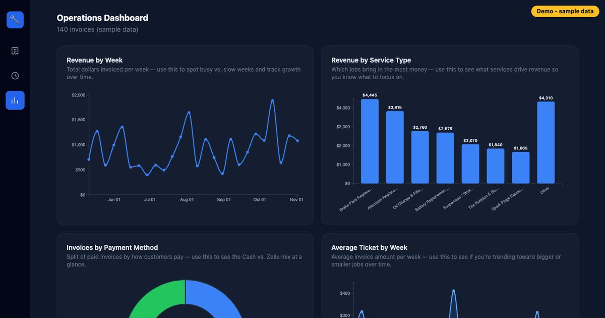

# Julio Salas — Developer Portfolio

Portfolio site for **Julio Salas**, a Full Stack & AI Engineer in New York (Bronx). It showcases production apps built for real NYC small businesses, an AI/RAG project, client websites, work experience, and contact info.

**Live:** https://webdesign-multimedia.github.io/Julio-Salas-Portfolio/



## Pages

- **`index.html`** — hero, summary, skills, experience, the top 4 featured projects, education, and contact.
- **`projects.html`** — all featured projects, client websites, and more projects.

## Featured projects

| Project | What it is | Links |
|---|---|---|
| Auto Shop Invoicing CRM | Next.js invoicing + CRM used daily by an NYC auto repair shop | [Demo](https://auto-shop-crm-demo.vercel.app) · [Code](https://github.com/WebDesign-MultiMedia/Auto-Shop-Invoicing-CRM) |
| NYC GPT | Streaming RAG chatbot (Next.js, TypeScript, LangChain.js, AstraDB) | [Demo](https://nyc-gpt.vercel.app) · [Code](https://github.com/WebDesign-MultiMedia/RAG-chatbot) |
| POS Invoice Manager | Point-of-sale + invoicing for a Bronx catering business, with Stripe | [Demo](https://pos-invoice-manager.vercel.app) · [Code](https://github.com/WebDesign-MultiMedia/POS-Invoice-Manager) |
| Suly’s Sweets | Bilingual bakery site + holiday pre-orders with Stripe Checkout | [Site](https://sulys-sweets.vercel.app) · [Code](https://github.com/WebDesign-MultiMedia/SulysSweets) |
| Casa TK | Bilingual React site for a Bronx café and bakery | [Site](https://casa-tk.vercel.app) · [Code](https://github.com/WebDesign-MultiMedia/Casa_TK) |

## How it's built

- **Static HTML, CSS, and vanilla JavaScript**, with no framework and no build step. It's hosted on GitHub Pages from the `main` branch.
- **`style.css`** holds the design tokens (colors, fonts, spacing) and every component style. The look is a dark terminal theme using JetBrains Mono + Inter.
- **`script.js`** is shared by both pages: the mobile menu, typewriter, scroll reveal, project count, footer year, and the Formspree contact form.
- **3D background:** a Three.js scene of floating code panels on the homepage. It loads from a CDN only on wide screens, only after the visitor first moves the mouse or scrolls (or after 7s), and never when `prefers-reduced-motion` is set. It's purely decorative.
- **Screenshots:** in `assets/screenshots/`, WebP captures of each project's live demo, taken with Playwright. They show demo or public data only.
- **Accessibility and SEO:** semantic landmarks, a skip link, visible focus styles, AA color contrast, alt text, lazy-loaded images, a unique title and description per page, Open Graph/Twitter cards, a canonical URL, and JSON-LD for the Person.

```
├── index.html
├── projects.html
├── style.css
├── script.js
└── assets/
    ├── screenshots/        # project screenshots (.webp)
    ├── og-image.jpg        # link-preview image
    └── Julio_Salas_Resume.pdf   # (add this file)
```

## Run locally

```bash
python3 -m http.server 8000   # or: npx serve .
# open http://localhost:8000
```

## Contact

- Jobs: jsalas198016@gmail.com
- Freelance & website projects: webdesignmultimediany@gmail.com
- LinkedIn: https://www.linkedin.com/in/julio-salas-webdeveloper/
- GitHub: https://github.com/WebDesign-MultiMedia
